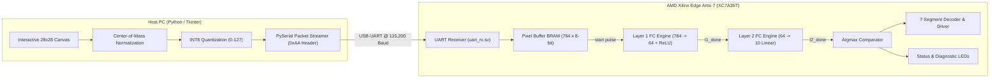

# Hardware-Accelerated Neural Network Digit Recognition on Edge Artix-7 FPGA

[-red.svg)](https://www.xilinx.com)
[](https://www.xilinx.com/products/design-tools/vivado.html)
[]()
[]()
[]()
[]()
[](LICENSE)

A synthesizable, hardware-software co-designed **Deep Learning Inference Accelerator** for real-time handwritten digit classification (MNIST) implemented in **pure SystemVerilog** on the **AMD Xilinx Edge Artix-7 FPGA (XC7A35T-1FTG256C)**.

The system integrates an interactive host GUI for live digit sketching, center-of-mass normalization, and high-speed packet streaming over USB-UART. On-chip, the FPGA buffers input pixels in dual-port **Block RAM (BRAM)**, computes matrix vector multiplications across two fully-connected layers using signed saturation arithmetic, and displays the classified digit (0–9) on a 7-segment display in real time.

---

## 1. System Architecture Overview



---

## 2. Key Technical Specifications

| Parameter | Specification | Hardware Implementation Details |
| :--- | :--- | :--- |
| **FPGA Target Device** | AMD Xilinx Edge Artix-7 | `XC7A35T-1FTG256C` (50 MHz onboard system clock) |
| **Network Topology** | Multi-Layer Perceptron (MLP) | Input: $784 \rightarrow$ Hidden: $64$ (ReLU) $\rightarrow$ Output: $10$ (Argmax) |
| **Data Representation** | 8-bit Quantized Signed Fixed-Point | Weights: `int8` $[-128, 127]$, Activations: `uint8/int8` |
| **Storage Architecture** | On-Chip Block RAM (BRAM) | Layer 1: $784 \times 64 = 50,176$ weights; Layer 2: $64 \times 10 = 640$ weights |
| **Arithmetic Engine** | Accumulator with Saturation | 32-bit signed accumulator with dynamic arithmetic shift (`>>> 7`) |
| **Communication Protocol** | Asynchronous Serial (UART) | 115,200 Baud, 8-N-1 with framed header byte `0xAA` |
| **Visual Output** | 7-Segment Display + Status LEDs | Predicted class (0–9) on anode `digit_en[0]`, activity diagnostic indicators |

---

## 3. RTL Hardware Architecture & Modules

### A. Top-Level Integration (`top_edge_artix7.sv`)
* Manages the complete control and datapath flow.
* Synchronizes frame packet reception: listens for header byte `0xAA`, writes sequential pixel data into `img_ram [0:783]`, and triggers `nn_start`.
* Cascades execution from `layer1_inst` to `layer2_inst` via handshaking flags (`start`, `done`).
* Computes the argmax across the 10 final output logits to extract the winning class (`predicted_digit`).

### B. Parameterized Fully-Connected Engine (`single_fc_engine.sv`)
* Parameterizable interface:
  ```systemverilog
  single_fc_engine #(
      .IN_NODES(784),
      .OUT_NODES(64),
      .IS_RELU(1),
      .MEM_WEIGHT("l1_weights.mem"),
      .MEM_BIAS("l1_biases.mem")
  ) layer1_inst ( ... );
  ```
* Dual-stage finite state machine (FSM) cycling through vector dot products.
* Memory initialization directly synthesizes into Block RAM primitives using `$readmemh`.
* Integrated ReLU non-linear activation unit and 8-bit saturation clamp to prevent numeric overflow.

### C. UART Receiver (`uart_rx.sv`)
* Hardware baud-rate generator sampling at `CLK_FREQ / BAUD_RATE` (434 ticks @ 50 MHz for 115,200 baud).
* Mid-bit oversampling for noise immunity and frame alignment.

---

## 4. Hardware Peripheral Pinout (`constraints.xdc`)

Mapped specifically for the **Edge Artix-7 FPGA development board**:

### Clock & Reset
| Port Name | FPGA Pin | I/O Standard | Description |
| :--- | :---: | :---: | :--- |
| `clk` | **`N11`** | LVCMOS33 | 50.00 MHz Primary Oscillator (Period: 20.00 ns) |
| `rst_btn` | **`K13`** | LVCMOS33 | Active-High Center Pushbutton (PB0 with pulldown) |

### Serial Interface
| Port Name | FPGA Pin | I/O Standard | Description |
| :--- | :---: | :---: | :--- |
| `uart_rx_i` | **`D4`** | LVCMOS33 | On-board FTDI USB-UART Serial RX Line |

### 7-Segment Display Cathodes & Anodes
| Segment / Port | FPGA Pin | Segment / Port | FPGA Pin |
| :--- | :---: | :--- | :---: |
| `Seven_Seg[0]` (A) | **`G2`** | `digit_en[0]` (Digit 1) | **`F2`** |
| `Seven_Seg[1]` (B) | **`G1`** | `digit_en[1]` (Digit 2) | **`E1`** |
| `Seven_Seg[2]` (C) | **`H5`** | `digit_en[2]` (Digit 3) | **`G5`** |
| `Seven_Seg[3]` (D) | **`H4`** | `digit_en[3]` (Digit 4) | **`G4`** |
| `Seven_Seg[4]` (E) | **`J5`** | | |
| `Seven_Seg[5]` (F) | **`J4`** | | |
| `Seven_Seg[6]` (G) | **`H2`** | | |

### Diagnostic Status LEDs
| LED Signal | FPGA Pin | Functional Indication |
| :--- | :---: | :--- |
| `led[0]` | **`J3`** | **UART Ingestion:** Pulses upon valid serial byte reception |
| `led[1]` | **`H3`** | **Inference Active:** High during Layer 1 computation |
| `led[2]` | **`K1`** | **Inference Complete:** High when Layer 2 output is locked |
| `led[3]` | **`L2`** | **Frame Sync:** Active while receiving 784-byte payload |

---

## 5. Software Co-Design Suite (`uart.py`)

The companion Python pipeline performs three critical functions:

1. **PyTorch Training & Quantization Pipeline:**
   * Trains a custom PyTorch model on the MNIST dataset with rotation/affine data augmentations.
   * Employs $L_2$ weight decay (`1e-5`) and `ReduceLROnPlateau` scheduling to maintain small weight distributions suitable for quantization.
   * Quantizes trained floating-point weights and biases into symmetric 8-bit integers (`[-128, 127]`) and exports memory files (`l1_weights.mem`, `l1_biases.mem`, `l2_weights.mem`, `l2_biases.mem`).

2. **Interactive Drawing GUI:**
   * A Tkinter 28×28 interactive grid canvas with soft anti-aliased brush dynamics.
   * Real-time center-of-mass shift (`scipy.ndimage.center_of_mass`) ensuring drawn digits match MNIST standard spatial distributions.

3. **Serial Streamer:**
   * Formats the normalized canvas into a 785-byte packet: `[0xAA, byte_0, byte_1, ..., byte_783]`.
   * Streams data across the virtual COM port directly into the Artix-7 FPGA Block RAM.

---

## 6. How to Run & Verify

### Step 1: Synthesize & Program the FPGA
1. Open **AMD Xilinx Vivado** and create a project targeting **`xc7a35tftg256-1`**.
2. Add all SystemVerilog source files:
   * `top_edge_artix7.sv`
   * `single_fc_engine.sv`
   * `uart_rx.sv`
3. Add memory initialization files:
   * `l1_weights.mem`, `l1_biases.mem`, `l2_weights.mem`, `l2_biases.mem`
4. Add the physical constraints file:
   * `constraints.xdc`
5. Run **Synthesis**, **Implementation**, and **Generate Bitstream**.
6. Open **Vivado Hardware Manager**, connect to your Edge Artix-7 board, and program the device.

### Step 2: Launch the Host GUI & Inference Interface
Ensure Python dependencies are installed:
```bash
pip install torch torchvision numpy scipy pyserial
```

Run the GUI interface:
```bash
python uart.py
```
* Draw any digit (0–9) on the canvas.
* Upon releasing the mouse, the normalized digit is streamed to the FPGA.
* The 7-segment display on the Edge Artix-7 board displays the classified digit instantly!

---

## Author & Acknowledgments

* **Author:** Pooja Pramod Nagvekar
* **Affiliation:** Vidyalankar Institute of Technology (VIT Mumbai)
* **License:** This project is open-source under the [MIT License](LICENSE).
